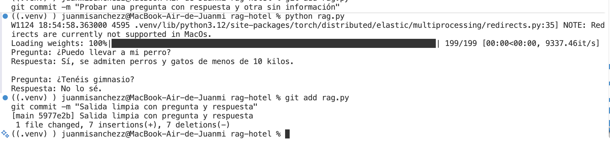

# RAG mínimo para un hotel

Proyecto 10 del máster de AI Engineering de thePower.

Es un RAG pequeño sobre 3 documentos de un hotel ficticio, el Hotel Mar Azul: normas, servicios y horarios, y tarifas y cancelación. Recibe una pregunta y la responde usando solo lo que pone en esos documentos. Si la respuesta no está, dice "No lo sé.".

## Cómo funciona

- **Ingesta:** leo los 3 `.txt` de la carpeta `docs/` y los parto en trozos con `RecursiveCharacterTextSplitter` de LangChain (400 caracteres y 60 de solapamiento). Salen 6 trozos.
- **Indexar:** cada trozo se guarda en la tabla `fragmentos` de PostgreSQL con pgvector (en Neon), junto al nombre del documento y su embedding. Los embeddings los saco en local con sentence-transformers (`paraphrase-multilingual-MiniLM-L12-v2`, 384 dimensiones, gratis y entiende español).
- **Recuperar:** convierto la pregunta en embedding con el mismo modelo y pido a Postgres los 3 trozos más cercanos por distancia coseno (`<=>`).
- **Generar:** junto esos 3 trozos en un solo texto, cada uno con el nombre de su documento delante, y se lo paso a llama3.1 en local con Ollama. El prompt le dice que responda solo con ese contexto y que, si la respuesta no está, conteste exactamente "No lo sé.". Uso temperatura 0 para que no se invente nada.

## Archivos

- `db.py`: conexión a la base de datos y función que convierte texto en embedding (el mismo que en el proyecto 9).
- `docs/`: los 3 documentos del hotel.
- `rag.py`: carga y trocea los documentos, los indexa, recupera, genera la respuesta y hace las 2 preguntas de prueba.

## Ejecutarlo

```
python3.12 -m venv .venv
source .venv/bin/activate
pip install -r requirements.txt
```

Crea un archivo `.env` con la cadena de conexión de tu base de datos de Neon (o de tu Postgres en Docker), con el nombre de variable que lee `db.py`.

Hace falta tener Ollama abierto y el modelo descargado:

```
ollama pull llama3.1
```

Y ejecuta:

```
python rag.py
```

La primera vez descarga también el modelo de embeddings (unos 470 MB).

## Resultado

```
Pregunta: ¿Puedo llevar a mi perro?
Respuesta: Sí, se admiten perros y gatos de menos de 10 kilos.

Pregunta: ¿Tenéis gimnasio?
Respuesta: No lo sé.
```

La primera pregunta está en `normas.txt` y la responde con lo que pone ahí. La del gimnasio no aparece en ningún documento, así que dice "No lo sé." en vez de inventarse algo.


